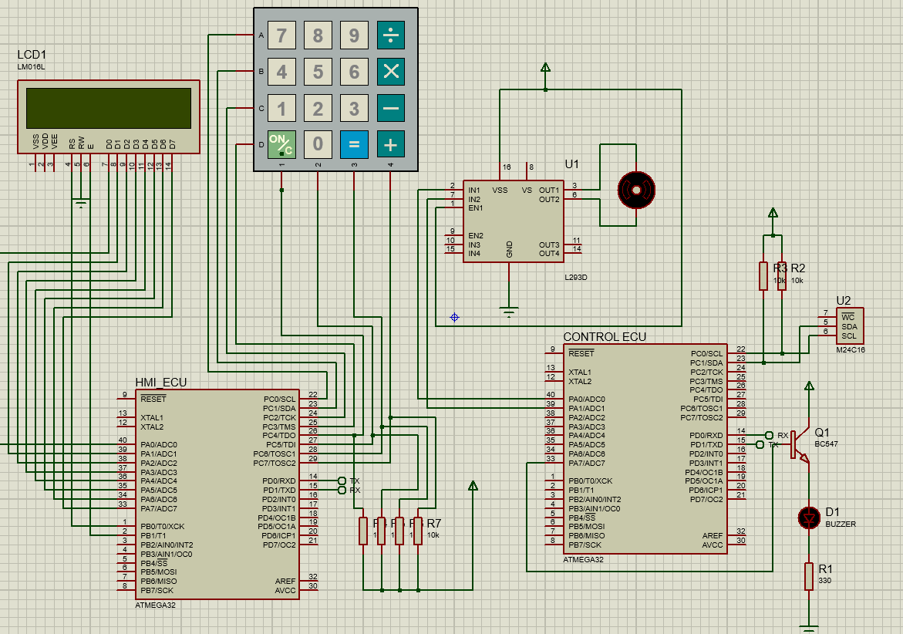

\# 🔐 Door Locker Security System

A password-protected door lock system built on \*\*two ATmega32 microcontrollers (8 MHz)\*\* communicating over UART, designed with a \*\*layered architecture\*\* (Application / HAL / MCAL).

\## 📌 System Overview

| ECU | Role | Peripherals |

|-----|------|-------------|

| \*\*HMI\_ECU\*\* | Handles user interaction only | 2x16 LCD, 4x4 Keypad |

| \*\*Control\_ECU\*\* | Handles all processing and decisions | External EEPROM, Buzzer, DC Motor |

## 🖼️ Simulation

\## ⚙️ How It Works

1\. \*\*Create Password:\*\* User enters a 5-digit password twice. HMI sends both to Control\_ECU over UART. If they match, the password is saved in the external EEPROM.

2\. \*\*Main Menu:\*\* `+ : Open Door` / `- : Change Pass`

3\. \*\*Open Door:\*\* Password is verified. If correct, the motor rotates CW for 15 s ("Door is Unlocking"), holds for 3 s, then rotates A-CW for 15 s ("Door is Locking").

4\. \*\*Change Password:\*\* After successful verification, the password creation step is repeated.

5\. \*\*Security Lockout:\*\* After \*\*3 consecutive wrong attempts\*\*, the buzzer is activated for 1 minute, an error message is displayed, and keypad input is blocked during that time.

\## 🧱 Architecture

\*\*HMI\_ECU\*\*

\- Application

\- HAL: LCD, Keypad

\- MCAL: GPIO, UART, Timer1

\*\*Control\_ECU\*\*

\- Application

\- HAL: Buzzer, External EEPROM, DC Motor

\- MCAL: GPIO, I2C (TWI), UART, Timer1

\## 🛠️ Drivers

\- \*\*GPIO:\*\* shared across both ECUs

\- \*\*UART:\*\* configurable via `UART\_ConfigType` (data bits, parity, stop bits, baud rate)

\- \*\*I2C (TWI):\*\* configurable via `TWI\_ConfigType` (address, bit rate)

\- \*\*Timer1:\*\* interrupt-based with callbacks, supports Normal and Compare modes through `Timer1\_ConfigType`

\- \*\*LCD / Keypad:\*\* 2x16 LCD and 4x4 keypad

\- \*\*DC Motor:\*\* runs at max speed using Timer0 PWM

\- \*\*Buzzer:\*\* pin selected via static configuration

\- \*\*External EEPROM:\*\* accessed over I2C

\## 🧰 Tools \& Technologies

\- ATmega32 @ 8 MHz

\- Embedded C

\- Proteus (simulation)

\- Layered architecture, interrupts, callbacks, configuration structures

\## 📂 Project Structure

├── HMI\_ECU/        → Keypad, LCD, UART, Timer1, GPIO

├── ECU/            → EEPROM, Buzzer, DC Motor, I2C, UART, Timer1, GPIO

└── Door\_Locker\_Simulation.pdsprj   → Proteus simulation

